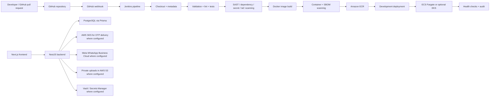

# IT Your IT House

IT Your IT House is a working Next.js platform for IT services, project intake, team matching, and internal admin workflows. The repository currently preserves the original dark, futuristic UI while evolving toward a production-grade full-stack system aligned to the attached DevSecOps platform requirements.

## Current implementation status

The project is intentionally in a phased state:

- Frontend demo flows for client, team, and admin workspaces are working and preserved.
- The local auth flow and project intake flow are functional in demo mode.
- A NestJS + Prisma backend scaffold is present and continues to be expanded.
- PostgreSQL, AWS, Jenkins, Terraform, Ansible, Docker, and external integrations are documented and scaffolded as production-ready infrastructure paths, not as live production resources.
- Real external services remain intentionally unconfigured until credentials and authorization are available.

This README reflects the honest implementation state and the next required steps to reach the full production-grade plan without pretending the platform is already live on AWS.

## System architecture



## Product overview

The application supports:

- Client workspace for project submission and tracking
- Team member workspace for matching, assignment, and milestone updates
- Creator/Admin center for approvals, audits, analytics, and notifications
- OTP-based login flow for demo and backend-enforced mode transitions
- Notification, project, and dashboard data modeled for persistence
- DevSecOps-oriented deployment flow and documentation for Jenkins, Docker, Terraform, Ansible, AWS, and security tooling

## Frontend and product flow

The frontend remains the familiar dark dashboard experience, with role-based workspaces in place and preserved. The app still functions as a local demo, while the backend foundation is being wired to support real persistence, sessions, and authorization.

Local UI flows:

- `/` landing page
- `/login` OTP flow
- `/dashboard` role-based workspace navigation
- project submission, review, and assignment actions
- role switching for client, team, and admin views

## Backend architecture

- Framework: NestJS REST API
- Persistence: Prisma ORM + PostgreSQL
- Auth: secure server-side session and OTP handling
- Cache/queue: Redis is documented only when required; it is not used as a default dependency for demo mode
- Runtime: Dockerized local development with optional production-like deployment targets

Backend directory:

- [backend/src](C:/Users/USER/OneDrive/Desktop/it-your-it-house/backend/src)
- [backend/prisma/schema.prisma](C:/Users/USER/OneDrive/Desktop/it-your-it-house/backend/prisma/schema.prisma)
- [backend/.env.example](C:/Users/USER/OneDrive/Desktop/it-your-it-house/backend/.env.example)

## Prisma and database model

The Prisma schema is created for the real production-oriented platform and includes models for:

- User
- Role and permission-aware access
- Session and OTP verification
- Team profiles and skills
- Projects and assignments
- Milestones, tasks, activity, and notifications
- File metadata, ratings, and audit logs
- Integration configuration entries

Production guidance:

- Keep PostgreSQL credentials outside source control.
- Use a not-shared development database for local testing.
- Run migration commands only in a controlled environment.
- Never reset production databases as a deployment step.

## Authentication and authorization status

The existing demo login is still intact. The production path is being implemented with a clear separation between:

- local demo flows
- backend session management
- secure RBAC rules server-side

Rules:

- Browser-supplied role values are never trusted.
- Admin status must be created only via controlled backend logic.
- OTPs are generated, validated, and stored in the backend path with expiry and single-use handling.
- SES and other external providers remain clearly marked as unconfigured until their credentials and authorization are available.

## Docker, Compose and local runtime

Production-oriented Docker configuration is scaffolded so the project can run in a containerized local environment without requiring AWS resources.

Files created:

- [Dockerfile](C:/Users/USER/OneDrive/Desktop/it-your-it-house/Dockerfile)
- [.dockerignore](C:/Users/USER/OneDrive/Desktop/it-your-it-house/.dockerignore)
- [backend/Dockerfile](C:/Users/USER/OneDrive/Desktop/it-your-it-house/backend/Dockerfile)
- [backend/.dockerignore](C:/Users/USER/OneDrive/Desktop/it-your-it-house/backend/.dockerignore)
- [compose.yaml](C:/Users/USER/OneDrive/Desktop/it-your-it-house/compose.yaml)

Local startup:

```powershell
npm install
npm run dev
```

Or with Docker:

```powershell
docker compose up --build
```

The Compose stack includes frontend, backend, and PostgreSQL. Production secrets are intentionally not embedded in Compose files.

## Jenkins, GitHub webhook and CI/CD

Jenkins pipeline configuration is scaffolded to match the requested production flow without assuming a live AWS environment or GitHub webhook is already configured.

Files created:

- [Jenkinsfile](C:/Users/USER/OneDrive/Desktop/it-your-it-house/Jenkinsfile)

Pipeline responsibilities:

- checkout and branch metadata
- lint and validation
- tests
- SAST and dependency scanning
- secret scanning
- Terraform/CloudFormation/Ansible checks
- Docker builds and Trivy scans
- AWS auth and ECR publishing
- deployment approval and health verification
- release notifications and audit metadata

Important constraints:

- GitHub webhooks must be authenticated and validated.
- Jenkins should not be exposed publicly without HTTPS and access control.
- Pull requests and untrusted branches are not deployed to production automatically.
- The pipeline should only claim success after the actual checks and deployments execute.

## Infrastructure as code and automation

The repository includes the expected infrastructure and automation scaffolding without creating cloud resources as part of this repository work.

Folders:

- [terraform](C:/Users/USER/OneDrive/Desktop/it-your-it-house/terraform)
- [cloudformation](C:/Users/USER/OneDrive/Desktop/it-your-it-house/cloudformation)
- [ansible](C:/Users/USER/OneDrive/Desktop/it-your-it-house/ansible)

Terraform is defined as the primary IaC path. CloudFormation is reserved for explicitly justified isolated stacks. Ansible is used for host configuration tasks rather than infrastructure lifecycle management.

## Security, scanning and release gates

The production workflow requires security gates for:

- SAST
- dependency scanning
- secret scanning
- container scanning
- Terraform and CloudFormation validation
- Ansible lint and syntax checks
- health checks and release verification

These are documented and implemented as pipeline stages in the Jenkinsfile. Findings must be reviewed, documented, and approved only with explicit ownership and expiry conditions.

## SES, WhatsApp and external integrations

The platform explicitly distinguishes between configured and unconfigured integrations:

- AWS SES: configured only when the required credentials and authorization exist
- Meta WhatsApp Business Cloud: configured only when app credentials, phone number ID, templates, and recipient consent are present
- S3 private uploads: enabled only when AWS storage policies and access paths are ready
- HashiCorp Vault or Secrets Manager: used only when a supported secret-management flow exists

The app must report Not configured or Configuration error accurately and never pretend a delivery or verification succeeded without actual evidence.

## Charts, analytics and avatars

The app includes the existing role workspaces and demo data flows. Real analytics endpoints and avatar persistence are planned to be gated on the database-backed backend. Charts must read real data or be clearly labelled as demo data until the data layer is connected.

The avatar builder remains a local, professional front-end concept that can be persisted once the secure database-backed user profile layer is active.

## Testing and verification

The current repo includes frontend tests and validation behavior:

```powershell
node --experimental-strip-types --test tests/*.test.mjs
npm run lint
npm run build
```

These checks must continue to pass while the backend and infrastructure scaffolding are expanded. The platform must not claim AWS, WhatsApp, SES, or Jenkins success without evidence from the actual configured environment.

## Implementation checklist

- [x] Audit the repository and preserve the working frontend
- [x] Create the backend and Prisma foundation
- [x] Add the security-conscious DevSecOps documentation and architecture overview
- [x] Add foundational Docker and Compose support
- [x] Add Jenkins, Terraform, Ansible, and infrastructure scaffolding
- [ ] Complete the secure database-backed auth and RBAC flow
- [ ] Connect frontend workspaces to real backend API data
- [ ] Persist projects, notifications, avatars, and analytics to PostgreSQL
- [ ] Integrate SES and WhatsApp with proper configuration checks
- [ ] Validate Docker builds and local compose startup in a real environment
- [ ] Validate Jenkins pipeline stages and webhook requirements
- [ ] Complete AWS deployment configuration only after explicit authorization

## Safe operational notes

- Never commit `.env` files, Terraform state, private keys, or deployment secrets.
- Never create paid AWS resources or production deployments without approval.
- Never reset or destroy production infrastructure without explicit authorization.
- keep the demo flows available while the production architecture is assembled.

## License

This project is intended for portfolio and controlled internal development use in the current workspace.
