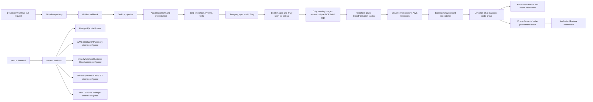

# IT Your IT House

IT Your IT House is a working Next.js platform for IT services, project intake, team matching, and internal admin workflows. The repository currently preserves the original dark, futuristic UI while evolving toward a production-grade full-stack system aligned to the attached DevSecOps platform requirements.

## Current implementation status

The project is intentionally in a phased state:

- Frontend demo flows for client, team, and admin workspaces are working and preserved.
- The local auth flow and project intake flow are functional in demo mode.
- A NestJS + Prisma backend scaffold is present and continues to be expanded.
- PostgreSQL, AWS, Jenkins, Terraform, Ansible, Docker, and external integrations are documented and scaffolded as production-ready infrastructure paths, not as live production resources.
- Real external services remain intentionally unconfigured until credentials and authorization are available.

This README reflects the honest implementation state and the next required steps to reach the full production-grade plan without pretending the platform is already live on AWS.

## System architecture



## Product overview

The application supports:

- Client workspace for project submission and tracking
- Team member workspace for matching, assignment, and milestone updates
- Creator/Admin center for approvals, audits, analytics, and notifications
- OTP-based login flow for demo and backend-enforced mode transitions
- Notification, project, and dashboard data modeled for persistence
- DevSecOps-oriented deployment flow and documentation for Jenkins, Docker, Terraform, Ansible, AWS, and security tooling

## Frontend and product flow

The frontend remains the familiar dark dashboard experience, with role-based workspaces in place and preserved. The app still functions as a local demo, while the backend foundation is being wired to support real persistence, sessions, and authorization.

Local UI flows:

- `/` landing page
- `/login` OTP flow
- `/dashboard` role-based workspace navigation
- project submission, review, and assignment actions
- role switching for client, team, and admin views

## Backend architecture

- Framework: NestJS REST API
- Persistence: Prisma ORM + PostgreSQL
- Auth: demo backend flow only; it is not production-ready
- Cache/queue: Redis is documented only when required; it is not used as a default dependency for demo mode
- Runtime: Dockerized local development with optional production-like deployment targets

Backend directory:

- [backend/src](C:/Users/USER/OneDrive/Desktop/it-your-it-house/backend/src)
- [backend/prisma/schema.prisma](C:/Users/USER/OneDrive/Desktop/it-your-it-house/backend/prisma/schema.prisma)
- [backend/.env.example](C:/Users/USER/OneDrive/Desktop/it-your-it-house/backend/.env.example)

## Prisma and database model

The current Prisma schema includes:

- User
- Role enum (not yet enforced through complete authorization guards)
- Session and OTP records
- Projects and client/assignee relationships
- Notifications

Production guidance:

- Keep PostgreSQL credentials outside source control.
- Use a not-shared development database for local testing.
- Run migration commands only in a controlled environment.
- Never reset production databases as a deployment step.

## Authentication and authorization status

The existing demo login is still intact. The backend currently returns the generated OTP in its response and issues a demo-shaped session token; complete session verification, authorization guards, rate limits, and secure OTP delivery are not implemented. Do not expose the application as a production service until these issues are fixed and reviewed. The intended separation is:

- local demo flows
- backend session management
- secure RBAC rules server-side

Rules:

- Browser-supplied role values are never trusted.
- Admin status must be created only via controlled backend logic.
- OTP records have expiry/single-use fields, but the current endpoint exposes the generated code and must be replaced with secure delivery.
- SES and other external providers remain clearly marked as unconfigured until their credentials and authorization are available.

## Docker, Compose and local runtime

Production-oriented Docker configuration is scaffolded so the project can run in a containerized local environment without requiring AWS resources.

Files created:

- [Dockerfile](C:/Users/USER/OneDrive/Desktop/it-your-it-house/Dockerfile)
- [.dockerignore](C:/Users/USER/OneDrive/Desktop/it-your-it-house/.dockerignore)
- [backend/Dockerfile](C:/Users/USER/OneDrive/Desktop/it-your-it-house/backend/Dockerfile)
- [backend/.dockerignore](C:/Users/USER/OneDrive/Desktop/it-your-it-house/backend/.dockerignore)
- [compose.yaml](C:/Users/USER/OneDrive/Desktop/it-your-it-house/compose.yaml)

Local startup:

```powershell
npm install
npm run dev
```

Or with Docker:

```powershell
docker compose up --build
```

The Compose stack includes frontend, backend, and PostgreSQL. Production secrets are intentionally not embedded in Compose files.

## Jenkins, GitHub webhook and CI/CD

The Jenkinsfile runs the existing application checks and security gates. AWS deployment is disabled by default and is only eligible on `main` when the `DEPLOY_TO_AWS` parameter is explicitly enabled. The branch gate accepts Jenkins Multibranch `BRANCH_NAME=main` and classic Pipeline Git plugin values `GIT_BRANCH=origin/main` or `GIT_LOCAL_BRANCH=main`. Infrastructure changes require a separate Jenkins input approval after the Terraform plan has been archived.

Files created:

- [Jenkinsfile](C:/Users/USER/OneDrive/Desktop/it-your-it-house/Jenkinsfile)

Before running the pipeline, install the Jenkins NodeJS plugin and add a NodeJS installation named `NodeJS-22` under **Manage Jenkins → Tools**. The pipeline provisions that tool on the agent so `node` and `npm` are available in validation and build stages.

The Prisma validation and backend image build use a non-production PostgreSQL placeholder URL only to validate the schema and generate the Prisma Client; they do not connect to a database. That build-stage value is not copied into the final backend image. At runtime, Jenkins retrieves database credentials through the EC2 instance profile and streams them directly into Kubernetes Secret resources without logging the values. The backend constructs its connection URL from the resulting environment variables.

Pipeline responsibilities:

- checkout and branch metadata
- verify Linux Jenkins-agent prerequisites, including Docker daemon access
- install frontend and backend dependencies from their lockfiles
- frontend/backend lint and TypeScript validation
- Prisma Client generation and schema validation with a CI-only URL
- frontend and backend test scripts
- Semgrep SAST using the pinned `semgrep/semgrep:1.181.0` container
- npm dependency audits
- Trivy filesystem dependency, secret, and supported infrastructure-configuration scans
- frontend and backend Docker builds, Trivy vulnerability scans, and CycloneDX SBOM generation
- Jenkins artifact reports under `reports/trivy/`
- optional IAM role verification, ECR publication by unique build tag and verified image digest, EKS/RDS deployment through Terraform-managed CloudFormation, an approved Kubernetes Prisma migration Job, rollout/health checks, and Prometheus/Grafana verification

Trivy is downloaded from the official Aqua Security GitHub release, pinned to `0.76.0`, and verified against the release checksum before use. The image policy is fixed to `CRITICAL`: either image failing the Trivy vulnerability scan stops the pipeline before ECR push. `TRIVY_FAIL_ON_SEVERITY` continues to configure the separate filesystem/configuration/secret scans. Image SBOMs and reports are archived with restricted Jenkins access.

Both production images upgrade Alpine packages during clean image builds and omit npm from the final runtime image. The frontend uses Next.js standalone output so its final image contains only traced runtime dependencies and static assets. Jenkins rebuilds both images with `--pull --no-cache`; successful local image scans precede the ECR publish stage. Each build gets a unique tag and deployment uses the digest returned by ECR for that same pushed image. The full frontend npm audit still reports five HIGH advisories through the `eslint-config-next` development-tool chain (`braces` → `micromatch` → `fast-glob`); `npm audit --omit=dev` is clean, and these development packages are absent from the standalone runtime tree. Do not treat the full development dependency audit as clean.

The Semgrep stage emits a JSON report; the dependency audit stage fails on high-severity npm findings while continuing later scans so reports can be collected. Trivy scans generate vulnerability/configuration JSON and readable summaries; the secret report omits matched values. Scan findings at or above the selected threshold fail the build. Keep Jenkins logs and artifacts access-controlled.

Important constraints:

- GitHub webhooks must be authenticated and validated.
- Jenkins should not be exposed publicly without HTTPS and access control.
- Pull requests and untrusted branches are never deployed to AWS.
- Jenkins uses the existing EC2 instance profile rather than static AWS access keys. Its role needs reviewed ECR, CloudFormation, EKS, EC2/VPC, RDS, Secrets Manager, Terraform state, and narrowly scoped `iam:PassRole` permissions for the cluster/node roles in the template.
- The pipeline does not create the Terraform state bucket automatically. Bootstrap it once as documented below and review/migrate any existing Terraform state before enabling deployment; Ansible discovers the bucket from the bootstrap CloudFormation output unless `TF_STATE_BUCKET` is explicitly set.
- Existing ECR repositories and the former Terraform-managed VPC are not auto-imported. The Terraform `removed` blocks prevent destruction only when the previous Terraform state is recovered and initialized. Existing CloudFormation stacks/resources must be imported or migrated before applying; a clean Terraform plan alone does not resolve resource ownership conflicts.
- No AWS resources have been created or changed by the repository work. A successful local CI run is not evidence of an AWS deployment.

## Local Prometheus and Grafana

The opt-in Compose overlay is for local development only; it does not deploy AWS infrastructure. AWS monitoring is deployed in the EKS cluster with the pinned `kube-prometheus-stack` Helm chart; there is no AMG/AMP stack or public monitoring service.

The backend exports authenticated Prometheus metrics at `/metrics` only when `METRICS_TOKEN_FILE` is configured. It records low-cardinality HTTP method/route/status counts and latency histograms, plus Node process CPU and memory metrics. The Prometheus-owned Node client is pinned at `@prometheus-io/client` 0.16.1 and requires Node 22+, so the backend image uses Node 22. The frontend and backend expose basic health endpoints used by HTTP probes. cAdvisor provides local container CPU/memory metrics; its host filesystem mounts are read-only, and neither cAdvisor nor the blackbox exporter has a host-published port.

Before starting monitoring, create two secret files outside the repository. On PowerShell:

```powershell
$secretDirectory = Join-Path $HOME ".config\it-your-it-house"
New-Item -ItemType Directory -Force $secretDirectory | Out-Null
$metricsTokenFile = Join-Path $secretDirectory "metrics-token"
$grafanaPasswordFile = Join-Path $secretDirectory "grafana-admin-password"
$rng = [Security.Cryptography.RandomNumberGenerator]::Create()
$randomBytes = New-Object byte[] 32
$rng.GetBytes($randomBytes)
[IO.File]::WriteAllText($metricsTokenFile, [Convert]::ToBase64String($randomBytes))
$securePassword = Read-Host "Choose a Grafana admin password" -AsSecureString
$passwordPointer = [Runtime.InteropServices.Marshal]::SecureStringToBSTR($securePassword)
try {
  [IO.File]::WriteAllText($grafanaPasswordFile, [Runtime.InteropServices.Marshal]::PtrToStringBSTR($passwordPointer))
} finally {
  [Runtime.InteropServices.Marshal]::ZeroFreeBSTR($passwordPointer)
}
$env:METRICS_TOKEN_FILE = $metricsTokenFile
$env:GRAFANA_ADMIN_PASSWORD_FILE = $grafanaPasswordFile
$env:GRAFANA_ADMIN_USER = "admin"
```

Then start the local app and monitoring stack:

```powershell
docker compose -f compose.yaml -f compose.monitoring.yaml up --build -d
```

Prometheus and Grafana are bound to loopback only at `http://localhost:9090` and `http://localhost:3001`; exporter ports are only available on the internal Compose network. Grafana's admin password is read from the external secret file. Prometheus and Grafana data persist in Compose volumes. Open the provisioned dashboard at `http://localhost:3001/d/it-your-it-house-health/it-your-it-house-application-health`.

Verify Grafana and Prometheus health, including active scrape targets, from Git Bash/WSL:

```sh
sh monitoring/verify.sh
```

This stack requires a Linux Docker engine for cAdvisor host metrics. Docker Desktop may expose its Linux VM's container metrics rather than Windows host resources. Do not expose the loopback ports or exporter services publicly. In AWS, Grafana and Prometheus are ClusterIP services only; use `kubectl port-forward` through the CIDR-restricted EKS API endpoint to view them.

## Infrastructure as code and automation

The repository includes the expected infrastructure and automation scaffolding without creating cloud resources as part of this repository work.

Folders:

- [terraform](C:/Users/USER/OneDrive/Desktop/it-your-it-house/terraform)
- [cloudformation](C:/Users/USER/OneDrive/Desktop/it-your-it-house/cloudformation)
- [ansible](C:/Users/USER/OneDrive/Desktop/it-your-it-house/ansible)

Ownership is deliberately separated:

- Terraform uses the separately bootstrapped remote state and manages the ECR registry and application CloudFormation stacks.
- CloudFormation is the sole owner of AWS resources, including VPC/networking, ECR, EKS, EC2 managed nodes, RDS, Secrets Manager, and IAM.
- Ansible checks the Jenkins agent and invokes Terraform; Jenkins applies Kubernetes manifests and Helm releases to the CloudFormation-owned EKS cluster. No AWS resource is independently managed by both Terraform and CloudFormation.

The remote Terraform backend is an S3 bucket bootstrapped from `cloudformation/terraform-state-stack.yaml`. The bucket has versioning, customer-managed KMS encryption, public-access blocking, TLS-only access, and S3 lock files. The bootstrap stack creates and retains the KMS key, enables rotation, and grants the named Jenkins EC2 role key access. Bootstrap is an AWS change and is not run automatically by this repo work. An authorized operator must execute this from the approved Jenkins/EC2 environment after reviewing the template:

```sh
aws cloudformation deploy \
  --stack-name it-your-it-house-terraform-state \
  --template-file cloudformation/terraform-state-stack.yaml \
  --capabilities CAPABILITY_IAM \
  --parameter-overrides \
    ProjectName=it-your-it-house \
    TerraformStateRoleName="<actual Jenkins EC2 IAM role name>" \
  --region us-east-1

aws cloudformation describe-stacks \
  --stack-name it-your-it-house-terraform-state \
  --query 'Stacks[0].Outputs[?OutputKey==`TerraformStateBucketName`].OutputValue | [0]' \
  --output text \
  --region us-east-1
```

The Ansible Terraform workflow reads the bucket name from the `TerraformStateBucketName` output of this bootstrap stack, so `TF_STATE_BUCKET` is optional. If set, `TF_STATE_BUCKET` overrides the discovered value. The stack grants the selected EC2 instance-profile role access to the state KMS key; that role must also be authorized to read/write/delete the state object and `.tflock` object in S3. When updating an existing bootstrap stack, review the CloudFormation change set and keep the retained state bucket and KMS key. Terraform >=1.10 is required for S3 lock-file support.

**Do not enable `DEPLOY_TO_AWS` until the prior Terraform state and AWS ownership are reconciled.** The historical config managed ECR repositories and a VPC directly. The current Terraform has non-destroying `removed` blocks to protect those prior addresses only if the old state is recovered and migrated. Ansible blocks Terraform planning while `module.network` remains in remote state and blocks an in-place application-stack update while the existing stack still contains ECS, ALB, or CloudFront resources. If a repository, VPC, or stack already exists without a matching CloudFormation stack in the active remote state, Terraform cannot safely adopt it automatically. Import or migrate the existing resources/state in a separately reviewed change first. Do not apply a plan that proposes replacement or deletion. `destroy = false` intentionally leaves old resources alive and unmanaged; an old VPC may include a billable NAT gateway, so inventory and migrate/retire it through an approved change before creating a duplicate network.

The application stack is planned/applied only on the `main` branch when `DEPLOY_TO_AWS=true`; Jenkins pauses for infrastructure and database-migration approvals. The application CloudFormation stack creates a generated-password PostgreSQL database. Jenkins runs the checked-in Prisma migration as a Kubernetes Job after a separate manual approval. Do not use this initial migration against an existing database without first checking/baselining its schema and making a tested backup.

The current templates create billable resources including an EKS control plane, two EC2 worker nodes, RDS, CloudWatch logs, ECR image storage, and data transfer. The application template does not define a NAT Gateway or Elastic IP. EKS, EC2, RDS/storage/backups, and logs can accrue charges while idle or in use; actual charges vary by region, usage, and duration. Estimate the planned lifetime in the AWS Pricing Calculator and inspect the Terraform plan before every approval. No live deployment or account-specific cost estimate is claimed.

### AWS EKS portfolio deployment

This workflow uses Terraform to create/update CloudFormation stacks for the existing ECR repositories and the EKS application infrastructure. Jenkins builds both existing Dockerfiles, runs Trivy on both images, and stops before ECR publication if either image has a Critical vulnerability. Passing images are pushed with unique build tags; deployment consumes the exact ECR digests returned for those tags. An approved Terraform application plan creates the EKS cluster, managed nodes, private PostgreSQL database, and IAM access entries. Jenkins then creates the Kubernetes application secrets/configuration, runs the Prisma migration only after a separate manual approval, deploys the workloads, and verifies service rollout and Prometheus scraping. It installs the pinned kube-prometheus-stack Helm chart in-cluster; Grafana and application services are ClusterIP-only, with no public ALB, CloudFront, Route 53, certificate, or public app endpoint.

Before enabling `DEPLOY_TO_AWS`, verify all of the following:

- Use the `main` branch and enable the Jenkins parameter `DEPLOY_TO_AWS`. Supply `KUBERNETES_OPERATOR_PRINCIPAL_ARN` as a real IAM user/role ARN in the same AWS account, distinct from the Jenkins role. Supply `KUBERNETES_API_ACCESS_CIDRS` as comma-separated trusted IPv4 CIDRs for the operator; `/0` is rejected. Jenkins discovers and adds its own public egress `/32`. Confirm the configured `KUBERNETES_VERSION` is supported in the selected region; the current default is `1.34`.
- Jenkins must run on the intended EC2 instance profile, with the reviewed least-privilege ECR, CloudFormation, EKS, EC2/VPC, RDS, Secrets Manager, S3 state and narrowly scoped `iam:PassRole` permissions. Do not add static AWS keys. The selected operator needs IAM permission to obtain EKS credentials and the namespace-scoped EKS access policy created by the stack.
- Reconcile the existing Terraform remote state and CloudFormation/ECR ownership before applying. The available local AWS CLI identity did not establish what Jenkins can see. Stop if the Terraform plan replaces/deletes an unrelated or pre-existing resource.
- The deployment creates a new VPC and EKS control plane with two managed worker nodes, a private RDS instance, Secrets Manager secrets, ECR storage, and CloudWatch logs. There is no NAT Gateway. Public subnet auto-assignment of public IPs is disabled; the EKS managed-node launch template explicitly assigns node public IPs so nodes can download ECR and monitoring images without a NAT Gateway. The managed node security groups do not open inbound access to the internet. The EKS public API remains IAM-authenticated and restricted to the supplied operator CIDRs plus Jenkins' discovered egress `/32`; Trivy's AWS-0040 exception is limited to this application template and expires 2027-01-17. Trivy's AWS-0039 check does not account for EKS default envelope encryption; Terraform, Jenkins, Ansible, and CloudFormation require Kubernetes 1.28+, and this narrowly scoped exception expires 2027-10-17. The findings remain visible in the archived Trivy reports; after expiry they fail the configured gate until the policy is reviewed. Kubernetes 1.28+ uses EKS default envelope encryption with an AWS-owned key, so a separate billable customer-managed KMS key is not created. The app, database, and Grafana have no public listener. Review the full plan and current AWS pricing before approval; EKS control-plane hours, EC2 nodes, RDS/storage/backups, CloudWatch ingestion/storage, ECR storage, and data transfer can incur charges for the duration of the demo.
- The app is exposed only through local port forwarding. From a trusted operator workstation with AWS CLI and `kubectl` configured for the same region/account:

  ```sh
  aws eks update-kubeconfig --region us-east-1 --name it-your-it-house-dev-cluster
  kubectl -n it-your-it-house-dev port-forward svc/frontend 3000:3000
  ```

  Open `http://127.0.0.1:3000`. For the private Grafana dashboard, use a second terminal:

  ```sh
  kubectl -n monitoring port-forward svc/monitoring-grafana 3001:80
  ```

  Then open `http://127.0.0.1:3001`. Use username `admin`; retrieve the generated password with `kubectl -n monitoring get secret grafana-admin -o jsonpath='{.data.admin-password}' | base64 --decode` from the authorized operator identity. Port-forward traffic is loopback-local; kubectl's connection to the IAM-authenticated EKS API uses TLS. Never enter real user credentials or display secrets in portfolio screenshots. The application is a demo, not production authentication software.
- The deployment is not verified until the actual Jenkins AWS identity has applied an approved plan and the build's rollout/scrape checks pass. No apply or deployment is performed by the local validation steps in this repository change.

For cleanup, first confirm the account, region, Terraform backend/state key, and exact application stack ownership. From the same initialized Terraform backend used for deployment, review the destroy plan and only apply it if every deletion is expected and demo-owned:

```sh
terraform -chdir=terraform plan -destroy -input=false -out=demo-cleanup.tfplan
terraform -chdir=terraform show -no-color demo-cleanup.tfplan
# Only after reviewing and approving the saved plan:
terraform -chdir=terraform apply -input=false demo-cleanup.tfplan
```

Before applying the reviewed destroy plan, disable deletion protection on the demo database; verify its identifier against the CloudFormation stack and account first:

```sh
aws rds modify-db-instance \
  --db-instance-identifier it-your-it-house-dev-postgres \
  --no-deletion-protection \
  --apply-immediately \
  --region us-east-1
aws rds wait db-instance-available \
  --db-instance-identifier it-your-it-house-dev-postgres \
  --region us-east-1
```

This removes the Terraform-managed registry and application CloudFormation stacks, including EKS, worker nodes, RDS, secrets, VPC/network resources, and cluster monitoring. ECR repositories are retained by policy; delete images/repositories only after verifying they are dedicated to this demo and unused. Do not delete the separately bootstrapped Terraform state stack, state bucket, KMS key, state/lock objects, Jenkins IAM role, or unrelated resources. Check for any retained RDS snapshot, ECR images, and CloudWatch log groups after stack deletion; remove only verified demo-owned leftovers if no longer needed. The deployment stack has not been applied or cleaned up by these changes.

Jenkins setup:

- EC2/Linux agent prerequisites: NodeJS 22 via the Jenkins NodeJS plugin (tool name `NodeJS-22`), Docker Engine with access granted only to the trusted Jenkins agent, Terraform >=1.10, AWS CLI v2, Ansible, `jq`, `curl`, `sha256sum`, and `tar`. The pipeline installs checksum-verified `kubectl` v1.34.0 and Helm v3.17.3 under its temporary workspace if they are missing or have a different version; no system-wide installation or root access is required. Docker-group membership is effectively root access; use only on a dedicated trusted agent, never loosen socket permissions.
- Use the EC2 instance profile, not static AWS access keys. Jenkins derives the deployment role ARN from its STS assumed-role identity; keep the EC2 instance profile attached to the intended role. Set `DEPLOY_TO_AWS=true` and provide the `KUBERNETES_OPERATOR_PRINCIPAL_ARN` and `KUBERNETES_API_ACCESS_CIDRS` values described above. `KUBERNETES_VERSION` defaults to `1.34`; verify regional support before deployment. For manual state-stack bootstrap, replace the `TerraformStateRoleName` placeholder with the actual Jenkins EC2 instance-profile role name from the STS assumed-role ARN. Set `TF_STATE_BUCKET` only if you need to override the bootstrap stack output. The operator IAM identity needs `eks:DescribeCluster` and the EKS access entry created by the stack. Restrict IAM actions and `iam:PassRole` to only the resources/roles needed by these templates.
- No Grafana Jenkins token or IAM Identity Center workspace assignment is needed. Grafana's generated admin password is stored in the application's Secrets Manager secret and is available only to appropriately authorized AWS identities.
- `ansible/playbooks/jenkins-setup.yml` is host-mutating and intentionally fails unless explicitly run with `-e allow_host_package_changes=true`; it does not configure Docker socket permissions or the AWS instance profile.
- Jenkins must be accessible only through approved authenticated HTTPS access. Artifact access must be restricted because SBOMs and scan reports reveal dependency details and repository paths.
- **Do not expose the current application as production.** The demo OTP endpoint returns the generated code and session tokens are demo-shaped; server-side authentication/authorization is not production-ready. The application and Grafana have no public listener; access requires IAM-authenticated, CIDR-restricted EKS API access and local port forwarding. Use demo data only and never real credentials, OTPs, sessions, or customer information. This network restriction is not a substitute for fixing auth/RBAC before any public launch.
- Jenkins waits for the separately approved one-off Prisma migration before applying the app workloads. The deployment fails rather than marking success if the migration, pod readiness, application health endpoints, or Prometheus scrape check fails.

## Security, scanning and release gates

Semgrep, npm audit, Trivy filesystem/secret/configuration/image scans, CycloneDX SBOMs, frontend/backend lint/type checking, Prisma validation, tests, and build checks are wired into Jenkins. The filesystem/configuration/secret Trivy severity gate defaults to HIGH and CRITICAL and is adjustable via the pipeline parameter. The image gate is fixed to CRITICAL and cannot be lowered by the parameter. Infrastructure misconfiguration findings are not ignored. Terraform plans and the Prisma migration require manual approval; AWS publishing/deployment is gated by `DEPLOY_TO_AWS` and `main`.

CloudFormation templates, remote state, and the Jenkins host have not been validated or deployed against the target AWS account. Add dedicated `cfn-lint`, `ansible-lint`, and Terraform security scanning (for example Checkov) only after pinning versions, reviewing their policy behavior, and adding CI reports. Do not describe the Jenkins host setup playbook as a real scan.

## SES, WhatsApp and external integrations

The platform explicitly distinguishes between configured and unconfigured integrations:

- AWS SES: configured only when the required credentials and authorization exist
- Meta WhatsApp Business Cloud: configured only when app credentials, phone number ID, templates, and recipient consent are present
- S3 private uploads: enabled only when AWS storage policies and access paths are ready
- HashiCorp Vault or Secrets Manager: used only when a supported secret-management flow exists

The app must report Not configured or Configuration error accurately and never pretend a delivery or verification succeeded without actual evidence.

## Charts, analytics and avatars

The app includes the existing role workspaces and demo data flows. Real analytics endpoints and avatar persistence are planned to be gated on the database-backed backend. Charts must read real data or be clearly labelled as demo data until the data layer is connected.

The avatar builder remains a local, professional front-end concept that can be persisted once the secure database-backed user profile layer is active.

## Testing and verification

The current repo includes frontend tests and validation behavior:

```powershell
node --experimental-strip-types --test tests/*.test.mjs
npm run lint
npx tsc --noEmit
npm ci
npm run test
npm run build
cd backend
npm ci --legacy-peer-deps
npx prisma generate
npx prisma validate
npm run lint
npx tsc --noEmit
npm test
npm run build
```

These commands are intended for a trusted Linux Jenkins agent with dependencies configured; Docker/AWS/template validation has not been run from this Windows workspace. The backend test script currently reports that no backend tests are configured. The platform must not claim AWS, WhatsApp, SES, or Jenkins deployment success without evidence from the actual configured environment.

## Implementation checklist

- [x] Audit the repository and preserve the working frontend
- [x] Create the backend and Prisma foundation
- [x] Add the security-conscious DevSecOps documentation and architecture overview
- [x] Add foundational Docker and Compose support
- [x] Add Jenkins, Terraform, Ansible, and infrastructure scaffolding
- [ ] Complete the secure database-backed auth and RBAC flow
- [ ] Connect frontend workspaces to real backend API data
- [ ] Persist projects, notifications, avatars, and analytics to PostgreSQL
- [ ] Integrate SES and WhatsApp with proper configuration checks
- [ ] Validate Docker builds and local compose startup in a real environment
- [ ] Validate Jenkins pipeline stages and webhook requirements
- [ ] Complete AWS deployment configuration only after explicit authorization

## Safe operational notes

- Never commit `.env` files, Terraform state, private keys, or deployment secrets.
- Never create paid AWS resources or production deployments without approval.
- Never reset or destroy production infrastructure without explicit authorization.
- keep the demo flows available while the production architecture is assembled.

## License

This project is intended for portfolio and controlled internal development use in the current workspace.
